# Captures email

18 images réelles des composants de production rendus localement. Données et états fictifs ; aucun email envoyé, aucun code ou lien secret affiché. Les captures ne prouvent pas une livraison en production.

## admin-health-failed-1440.png

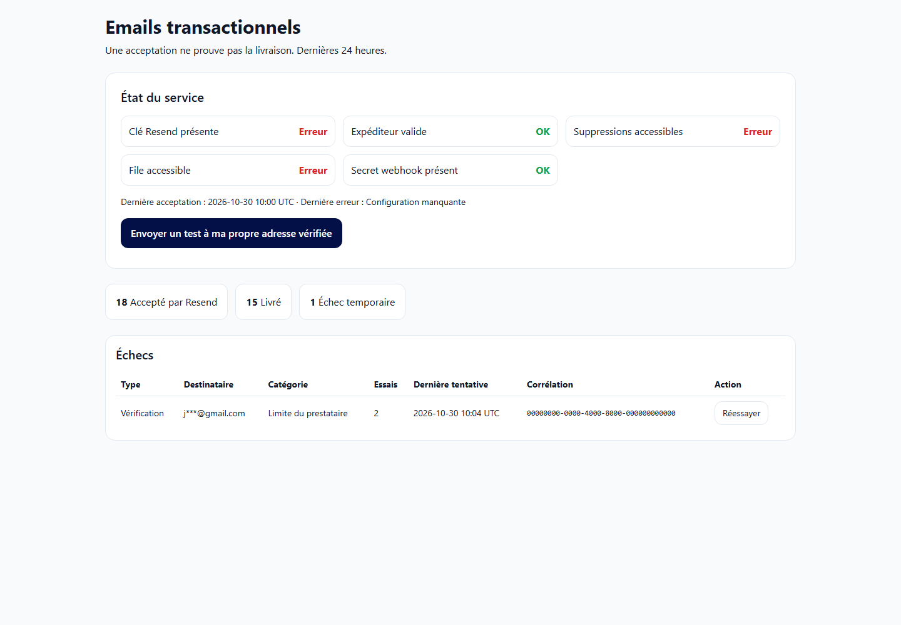

## admin-health-ok-1440.png

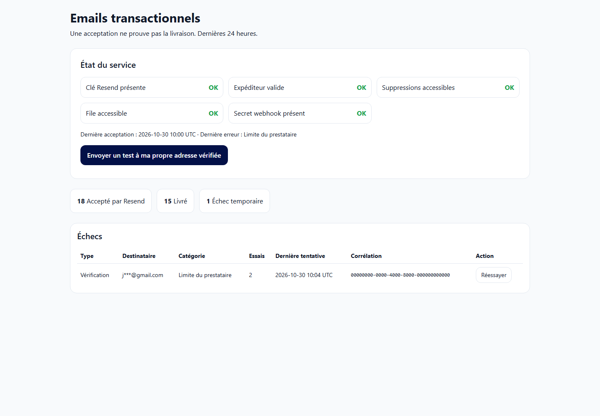

## code-neutral-fr-390.png

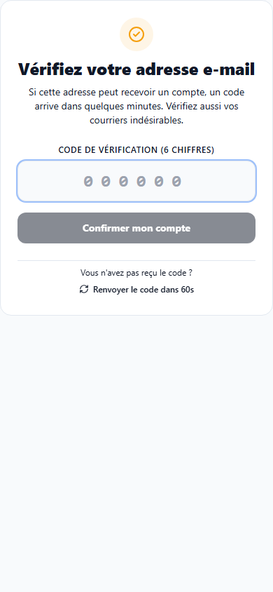

## code-neutral-ht-390.png

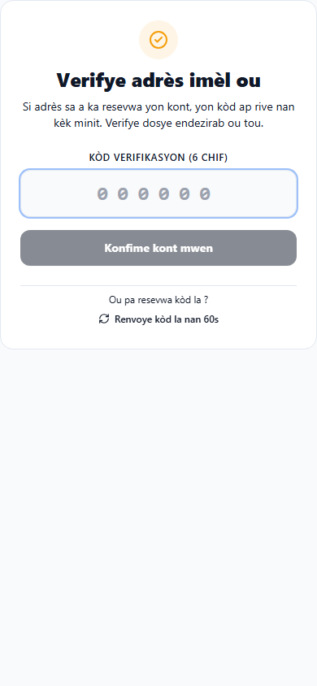

## email-invitation-fr.png

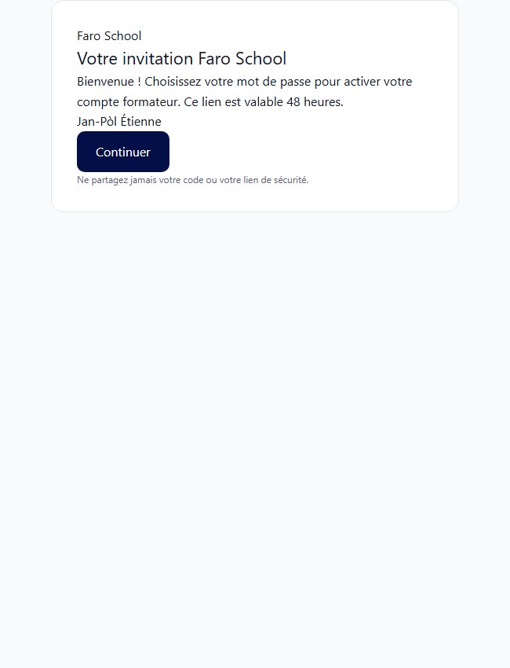

## email-invitation-ht.png

## email-payment_confirmed-fr.png

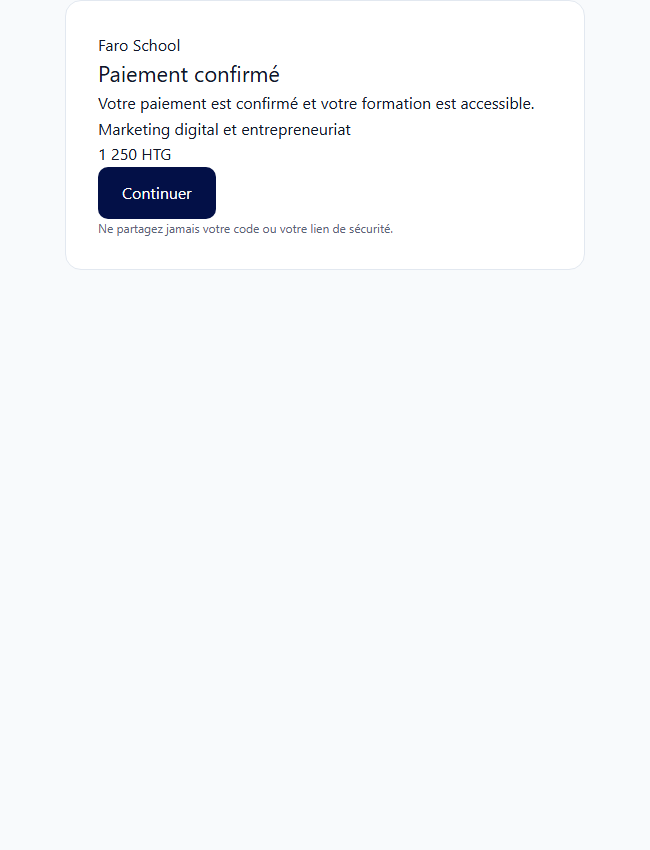

## email-payment_confirmed-ht.png

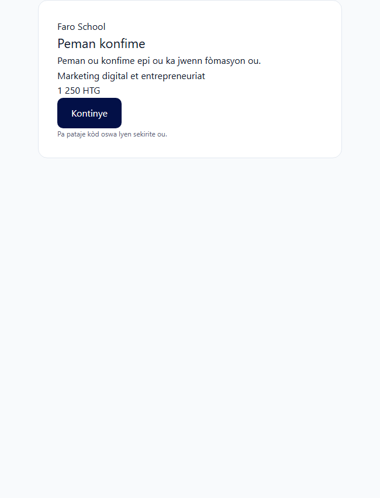

## email-reset-fr.png

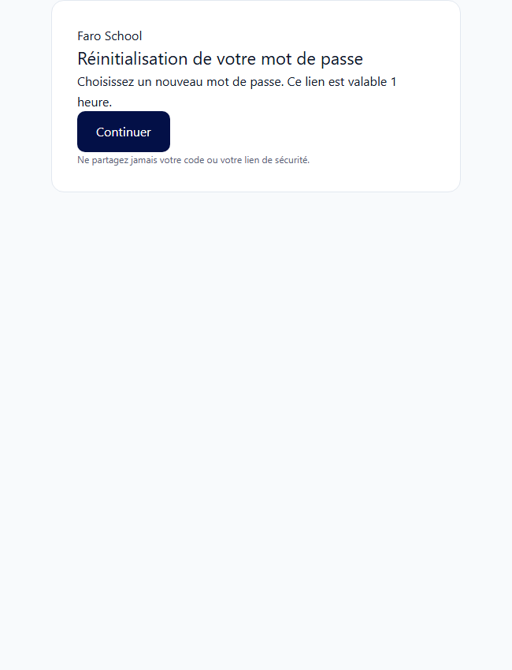

## email-reset-ht.png

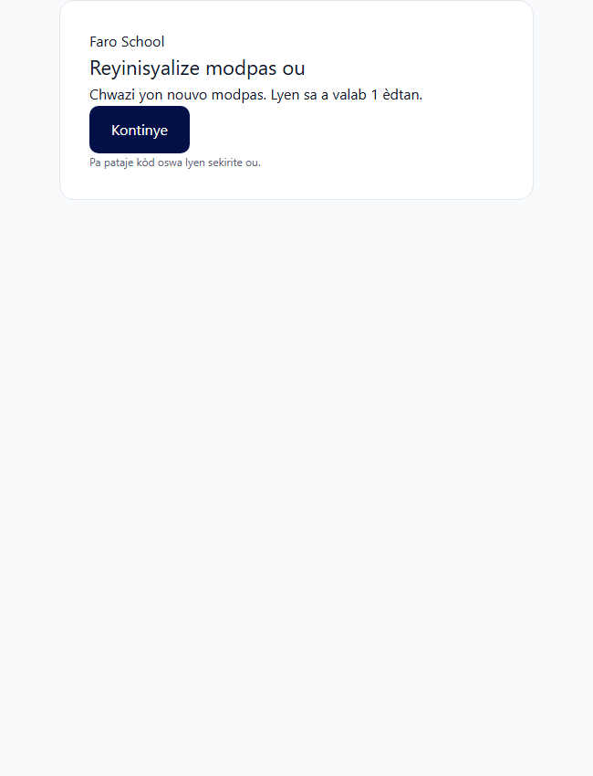

## email-verification-fr.png

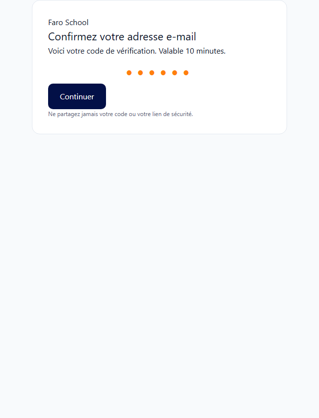

## email-verification-ht.png

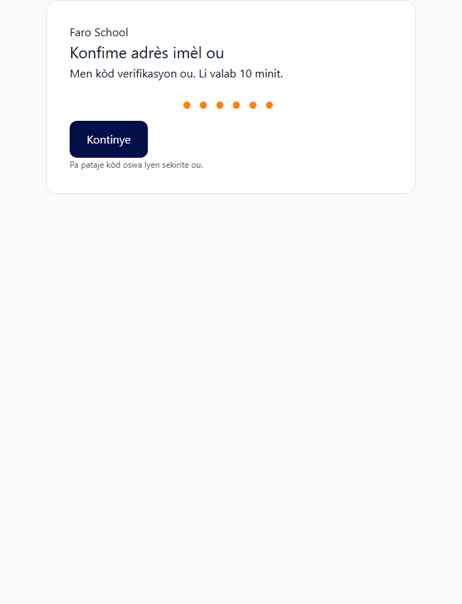

## verification-fr-already_used-390.png

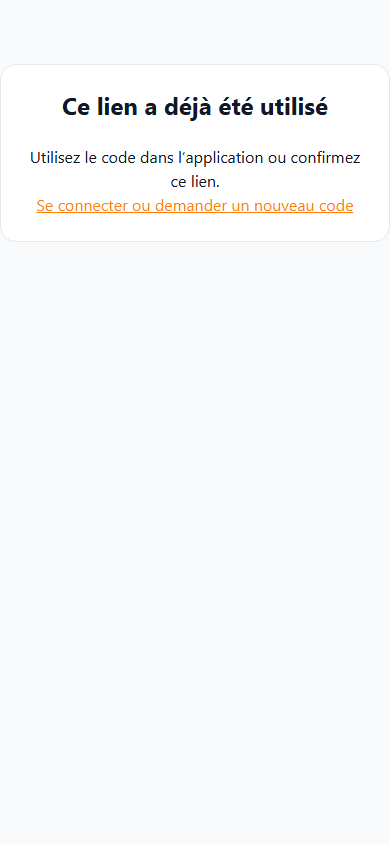

## verification-fr-expired-390.png

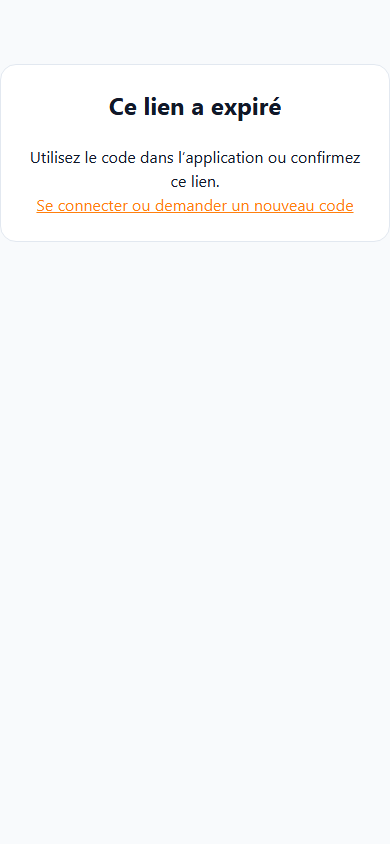

## verification-fr-valid-390.png

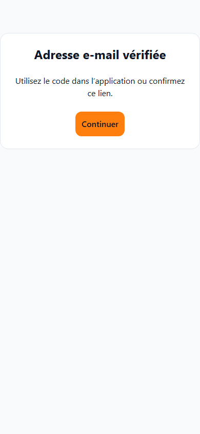

## verification-ht-already_used-390.png

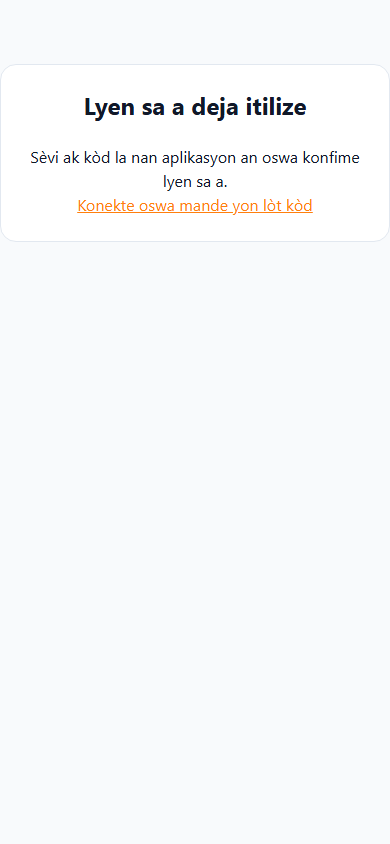

## verification-ht-expired-390.png

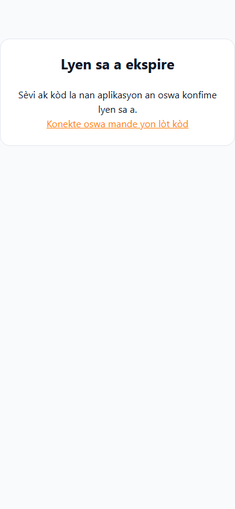

## verification-ht-valid-390.png

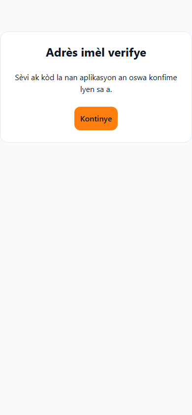
